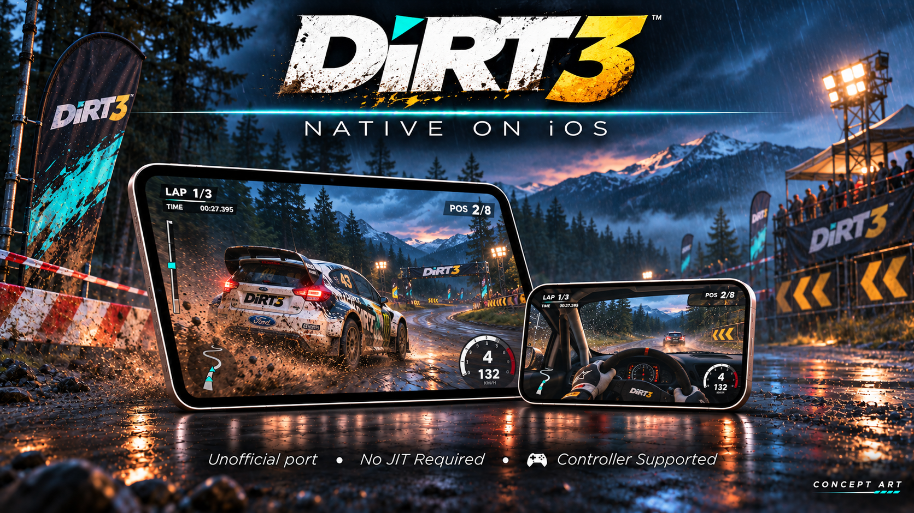

# [AS] DiRT 3 — Native iOS Port

An unofficial native port of **DiRT 3** for iPhone and iPad, using ahead-of-time recompilation of the original PlayStation 3 code and Metal rendering.

*Banner is concept artwork, not a captured device screenshot.*

## Specifications

| Feature | Details |
| --- | --- |
| Source game | DiRT 3 — PS3 EU disc, `BLES01548`, version 01.01 |
| Platforms | iPhone and iPad |
| Graphics | Metal |
| Execution | Ahead-of-time (AOT) recompiled PPU and SPU code via [ps3recomp](https://github.com/sp00nznet/ps3recomp); no JIT required |
| Controls | On-screen controls and MFi, Xbox, or PlayStation controllers |
| Display | Landscape orientation |

## Requirements

| Requirement | Details |
| --- | --- |
| Operating system | iOS 18.0 or later / iPadOS 18.0 or later (current project target) |
| Game ownership | Your own legally obtained copy of the supported PS3 game |
| Game data | Extracted game files and a decrypted game executable; approximately 6.7 GB of game data, plus space for the app and runtime data |
| Device specifications | Minimum chip and RAM requirements have not yet been verified |
| Performance | Device compatibility, frame rate, and stability have not yet been verified |

Game files, firmware, and generated game code are not included in this repository.

## Development Status

- **iOS / iPadOS:** Early development. On-device operation has not yet been verified.
- **macOS:** Version in development. Not yet available; macOS requirements will be published when confirmed.
